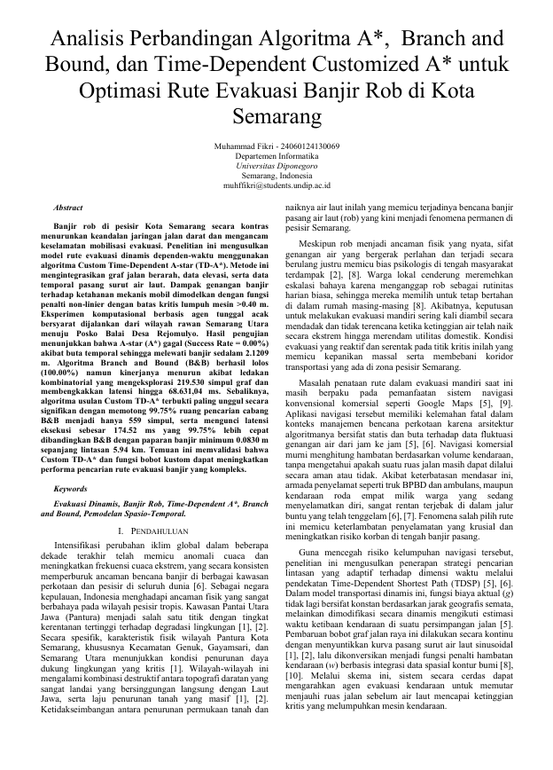

# Flood Tidal (Rob) Evacuation Routing: Comparing A*, Branch and Bound, and Custom Time-Dependent A*

Computational experiment comparing three evacuation-routing algorithms over the
flood-prone coastal road network of Semarang, Indonesia. Final project for the
**Algorithm Analysis and Strategy** course, Diponegoro University.

Full report: [Comparative Analysis of A-Star, Branch and Bound, and Time-Dependent
Customized A-Star for Flood and Tidal Rob Evacuation in Semarang City.pdf](Comparative%20Analysis%20of%20A-Star,%20Branch%20and%20Bound,%20and%20Time-Dependent%20Customized%20A-Star%20for%20Flood%20and%20Tidal%20Rob%20Evacuation%20in%20Semarang%20City.pdf)

<div align="center">
  <a href="Comparative%20Analysis%20of%20A-Star,%20Branch%20and%20Bound,%20and%20Time-Dependent%20Customized%20A-Star%20for%20Flood%20and%20Tidal%20Rob%20Evacuation%20in%20Semarang%20City.pdf"></a>
</div>

## Experiment Overview

Goal: route a car agent from a low-lying point in Semarang Utara (north coast,
the area that floods first during high tide) to a designated evacuation shelter
(Posko Balai Desa Rejomulyo) while the tide is rising.

Three algorithms are compared on the same road graph and tide data:

<center>
| Algorithm        | Role                                           |
| ---------------- | ---------------------------------------------- |
| Standard A\*     | static baseline, blind to flooding             |
| Branch and Bound | exact control, DFS + pruning                   |
| Custom TD-A\*    | proposed; A\* with time-dependent edge weights |
</center>

**Physical model.** Water depth at each node = sea level at time `t` (BMKG tide
data, 10-minute resolution) minus terrain elevation (DEMNAS raster). A penalty
factor `w(d)` models how the car is degraded by standing water:

- `d < 0.20 m` -> `w = 1.0` (dry road, normal speed)
- `0.20 <= d <= 0.40 m` -> `w = 2.5` (car slows down)
- `d > 0.40 m` -> `w = inf` (engine dies, road impassable, branch pruned)

**Scenario.** Single car agent, normal speed 8.33 m/s (30 km/h), departs at
minute 60 (rising-tide phase). Start: random node in Semarang Utara with terrain
elevation <= 1.0 m. Goal: Posko Balai Desa Rejomulyo.

### Results

<center>
| Metric         | Standard A\* | Branch and Bound | Custom TD-A\* |
| -------------- | ------------ | ---------------- | ------------- |
| Running time   | 31.61 ms     | 68.63 s          | 174.52 ms     |
| Nodes explored | 576          | 219,530          | 559           |
| Peak memory    | 307.79 KB    | 363.02 KB        | 306.26 KB     |
| Route length   | 3.17 km      | 5.88 km          | 5.94 km       |
| Flood exposure | 2.1209 m     | 0.4781 m         | 0.0830 m      |
| Success rate   | 0.00%        | 100.00%          | 100.00%       |
</center>

**Key findings:**

- Standard A\* fails outright. Fast and cheap, but its geometrically shortest
  route (3.17 km) drives straight into the deepest flood zone (2.12 m). Engine
  dies; success rate 0%.
- Branch and Bound produces a physically safe route but is impractically slow:
  without a goal heuristic it explores 219,530 nodes and takes 68.63 s. Not
  usable for real-time evacuation navigation.
- Custom TD-A\* wins on every practical metric. Only 559 nodes explored (99.75%
  fewer than B&B), 174.52 ms latency (99.75% faster than B&B), lowest flood
  exposure (0.083 m), 100% success. The dynamic penalty function makes the
  route bend away from roads that will drown before the tide peaks.

## Repository Layout

```
.
├── notebooks/
│   └── evacuation_simulation_v1.ipynb   # full pipeline: data -> algorithms -> results -> figures
├── data/
│   ├── chart_data.csv                   # BMKG tide series (EST column, 10-minute interval)
│   └── DEMNAS_1409-22_v1.0.tif          # national terrain elevation raster
├── spatial_map/                         # Semarang flood / rob risk maps
├── literature/                          # supporting papers and references
├── screenshots/                         # report screenshots
├── Comparative Analysis of A-Star, ... Semarang City.pdf
└── Proyek Makalah Analisis dan Strategi Algoritma 2026 (1).pdf
```

## Running the Notebook

`notebooks/evacuation_simulation_v1.ipynb` is the single notebook; run the cells
top to bottom.

1. Place two files in the working directory next to the notebook:
   - `chart_data.csv` (tide data, from `data/`)
   - `DEMNAS_1409-22_v1.0.tif` (terrain, from `data/`)
2. Execute all cells.

Outputs: a results table (displayed in-cell) plus three saved figures:
`Figure_3_komponen_spasial.png`, `Figure_5_komparasi_spasial.png`,
`Figure_6_analisis_trajektori.png`.

Note: the Branch and Bound cell takes over a minute. That slowness is a result
of the experiment, not a bug.

## Libraries

- OSMnx - OpenStreetMap road graphs
- rasterio - reading the DEMNAS terrain raster
- networkx + heapq - A*, B&B, and TD-A* implementations
- matplotlib - map and chart figures
